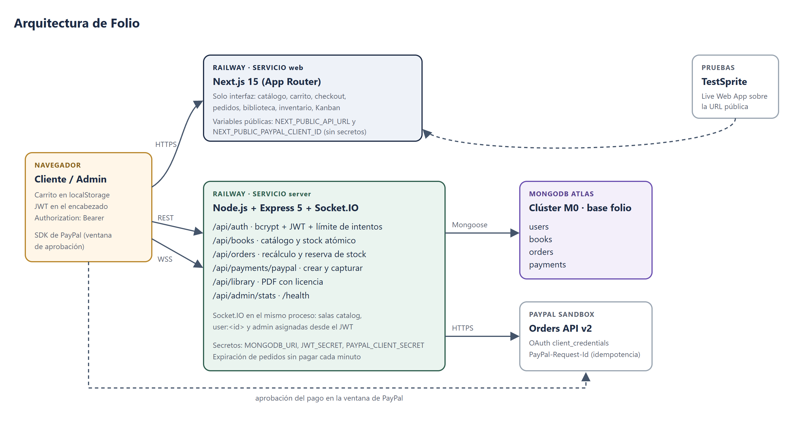
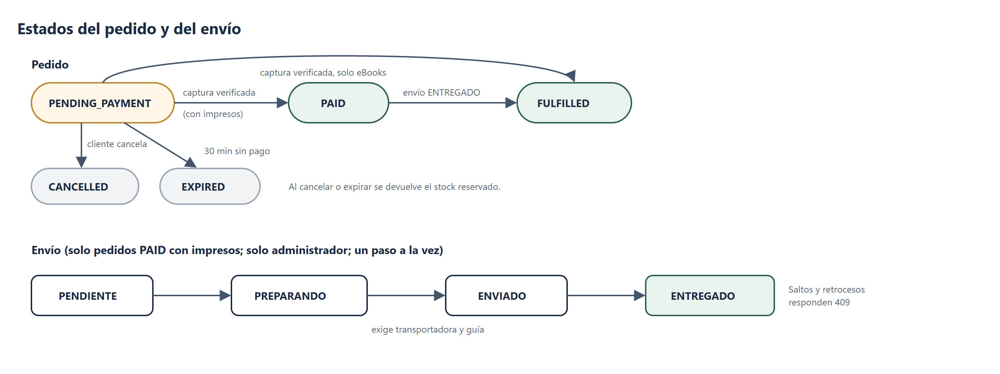

# Folio · Tienda de libros electrónicos

Laboratorio N.º 4 de Fundamentos de Sistemas de Información (UdeA, 2026-2): aplicación de comercio electrónico generada con asistencia de IA.

Folio vende libros electrónicos con descarga inmediata y, para parte del catálogo, la edición impresa con envío. Incluye catálogo, gestión de stock, carrito, pedidos, pago con PayPal Sandbox, gestión de envíos y un tablero en tiempo real.

| | URL |
|---|---|
| Frontend | https://web-production-fcfa8733.up.railway.app |
| Backend | https://server-production-60ae2691.up.railway.app ([`/health`](https://server-production-60ae2691.up.railway.app/health)) |

Ambos servicios corren en Railway (proyecto `folio`, servicios `server` y `web`, cada uno desplegado desde su carpeta). Cuentas de prueba: `cliente@folio.test` y `admin@folio.test` (contraseñas entregadas con el informe).

Documentos: [PRD.md](PRD.md) (requisitos y criterios de aceptación) · [PLAN.md](PLAN.md) (plan de implementación).

## Actores

- **Cliente:** explora, compra, paga, descarga sus eBooks y sigue sus envíos.
- **Administrador:** gestiona libros y stock, ve indicadores y despacha pedidos en el tablero.

## Arquitectura



```
lab4fsi/
├─ server/   API REST + Socket.IO (Node.js, Express 5, Mongoose, TypeScript)
├─ web/      Interfaz (Next.js 15, App Router, Tailwind)
└─ docs/     Diagramas y capturas
```

### Decisiones y justificación

| Decisión | Justificación |
|---|---|
| Backend separado del frontend | Las API y los WebSockets comparten un proceso; la lógica de pagos y los secretos nunca llegan al navegador |
| eBook + edición impresa opcional | El enunciado pide libros electrónicos **y** stock y envíos: el stock y el envío aplican al impreso; el eBook se entrega al confirmar el pago |
| Precios en centavos (enteros) | Evita errores de coma flotante en totales y en la comparación con PayPal |
| Reserva de stock al crear el pedido con `updateOne` condicional (`stock >= cantidad`) | Dos compras simultáneas no pueden vender la misma unidad; si el pedido se cancela o expira (30 min) el stock vuelve |
| Verificación de la captura en el servidor | El pedido solo se marca pagado si PayPal responde COMPLETED con el mismo importe, moneda y `custom_id` del pedido |
| `PayPal-Request-Id` y registro de pagos | Repetir la captura no cobra dos veces y devuelve el resultado conocido |
| JWT en `Authorization: Bearer` | Frontend y backend viven en dominios distintos de Railway; las cookies entre sitios serían bloqueadas |
| Salas de Socket.IO asignadas desde el JWT | El navegador no puede suscribirse a la sala de administración ni a pedidos ajenos |
| USD como moneda | PayPal no procesa pesos colombianos |

## Modelo de datos (MongoDB)

| Colección | Campos principales | Reglas |
|---|---|---|
| `users` | name, email (único), passwordHash, role, timestamps | role ∈ {cliente, admin}; contraseña con bcrypt (costo 12); el hash nunca se devuelve |
| `books` | title, author, category, description, isbn, pages, year, ebookPriceCents, printPriceCents, stock, active | precios enteros positivos; stock ≥ 0; `printPriceCents = null` si no hay impreso |
| `orders` | userId, items[{bookId, title, format, quantity, unitPriceCents}], shipping, subtotalCents, shippingCents, totalCents, currency, status, paymentStatus, paidAt, shipment{status, carrier, trackingNumber, history}, timestamps | total recalculado en el servidor; precio congelado en cada línea; eBook con cantidad 1 |
| `payments` | orderId, userId, provider, providerOrderId (único), captureId, amountCents, currency, status, failureReason | no se guardan datos de tarjeta; una orden PayPal por registro |



## Endpoints y reglas de autorización

| Método y ruta | Propósito | Acceso |
|---|---|---|
| `POST /api/auth/register` | Crear cuenta | Público; el rol siempre es cliente |
| `POST /api/auth/login` | Iniciar sesión | Público; 20 intentos por IP cada 15 min; error genérico |
| `GET /api/auth/me` | Usuario actual | Autenticado |
| `GET /api/books?category=&q=` | Catálogo | Público (inactivos solo para admin) |
| `GET /api/books/:id` | Detalle | Público |
| `POST /api/books` · `PATCH /api/books/:id` | Crear y editar libros | Admin |
| `PATCH /api/books/:id/stock` | Ajustar stock (`delta`) sin quedar negativo | Admin |
| `POST /api/orders` | Crear pedido (rechaza campos como `price`) | Cliente |
| `GET /api/orders/me` | Historial propio | Cliente |
| `GET /api/orders/:id` | Detalle | Dueño o admin (otros reciben 404) |
| `POST /api/orders/:id/cancel` | Cancelar pedido sin pagar | Dueño |
| `GET /api/orders` | Pedidos pagados con cliente (tablero) | Admin |
| `PATCH /api/orders/:id/shipment` | Avanzar el envío un paso | Admin |
| `POST /api/payments/paypal/order` | Crear orden PayPal con el total del servidor | Dueño del pedido |
| `POST /api/payments/paypal/capture` | Capturar, verificar y confirmar | Dueño del pedido |
| `GET /api/library` | eBooks comprados | Cliente |
| `GET /api/library/:orderId/:bookId/download` | PDF con licencia | Dueño de un pedido pagado |
| `GET /api/admin/stats` | Indicadores | Admin |
| `GET /health` | Estado del servicio y de la base de datos | Público |

Eventos Socket.IO: `stock:updated` (sala `catalog`), `order:paid` (sala `admin`), `order:updated` (salas `user:<id>` y `admin`).

## Ejecución local

Requisitos: Node.js 20+, una base MongoDB (Atlas o local) y credenciales de PayPal Sandbox.

```bash
# Backend
cd server
cp .env.example .env          # completar MONGODB_URI, JWT_SECRET, PayPal y contraseñas del seed
npm install
npm run seed                  # 16 libros y cuentas de prueba
npm run dev                   # http://localhost:4000

# Frontend
cd web
cp .env.example .env.local    # NEXT_PUBLIC_API_URL y NEXT_PUBLIC_PAYPAL_CLIENT_ID
npm install
npm run dev                   # http://localhost:3000
```

Pruebas del backend (38, con MongoDB en memoria y PayPal simulado): `cd server && npm test`.

### Variables de entorno

| Servicio | Variable | Secreta |
|---|---|---|
| server | `MONGODB_URI`, `JWT_SECRET`, `PAYPAL_CLIENT_SECRET` | Sí |
| server | `PAYPAL_CLIENT_ID`, `PAYPAL_API_BASE`, `CLIENT_ORIGIN`, `PORT` | No |
| web | `NEXT_PUBLIC_API_URL`, `NEXT_PUBLIC_PAYPAL_CLIENT_ID` | No (se incluyen en el JavaScript público) |

Ningún archivo `.env` se sube al repositorio.
